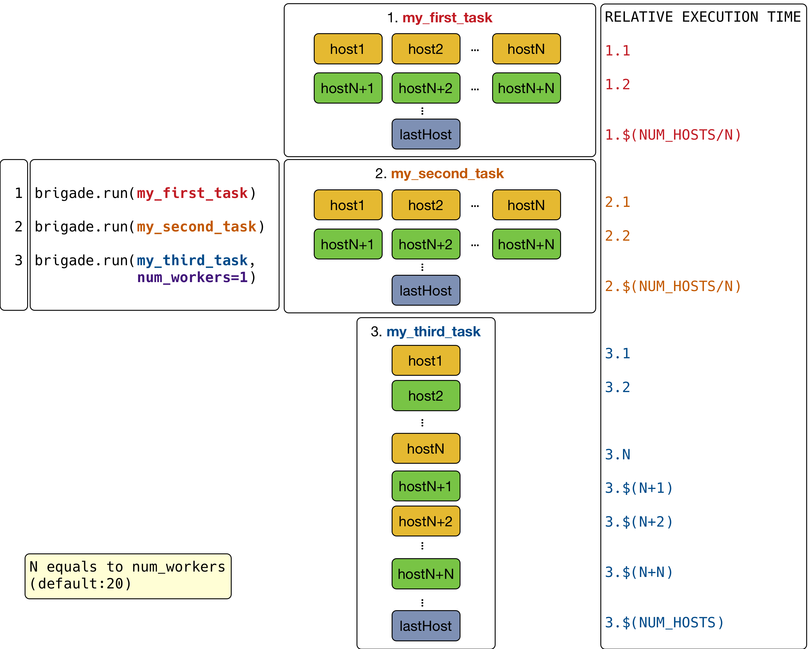
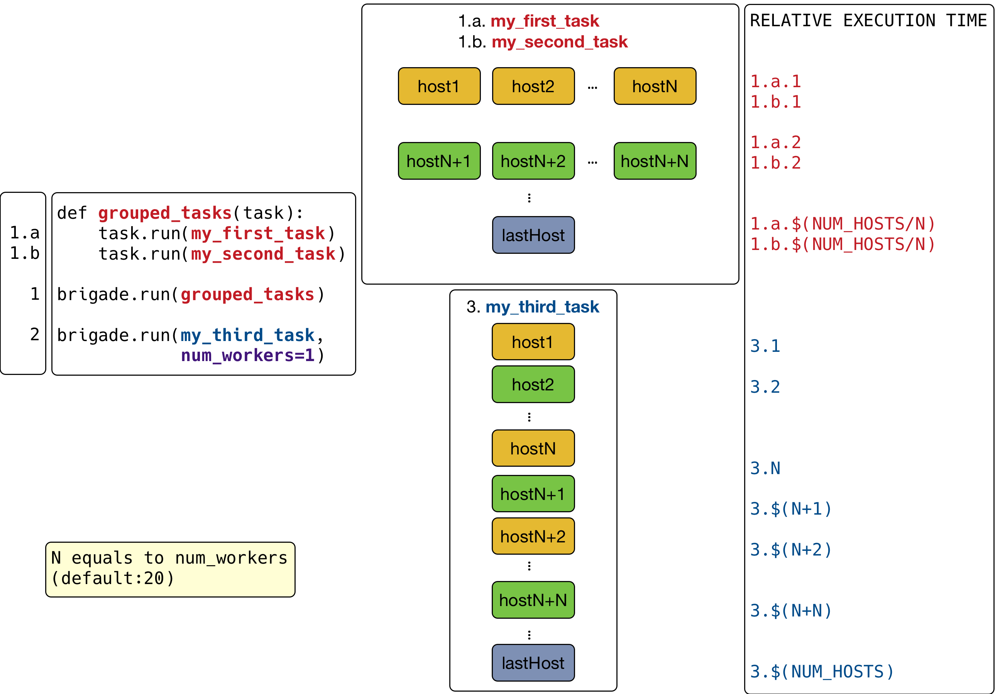

Execution Model
===============

Nornir delegates host concurrency to its configured runner. It includes three execution
modes:

* ``ThreadedRunner`` is the default. :obj:`nornir.core.Nornir.run` executes synchronous
  tasks in a thread pool, with at most ``num_workers`` hosts in flight. The default is
  20 workers; setting it to 1 serializes host execution while retaining the thread-pool
  runner.
* ``SerialRunner`` executes synchronous tasks for one host at a time in the caller's
  thread. This is useful for troubleshooting, stepping through tasks, or accessing a
  resource that must not be used concurrently.
* ``AsyncioRunner`` is opt-in. :obj:`nornir.core.Nornir.arun` executes native
  ``async def`` tasks on the caller's event loop, with at most ``num_workers`` hosts in
  flight. It does not create a thread per host. See the executed
  :doc:`../howto/asyncio_runner` notebook for a complete example.

Execution entry points are explicit. ``run()`` accepts synchronous tasks and ``arun()``
accepts coroutine tasks. Passing a coroutine task to ``run()`` is rejected with
``AsyncTaskOnSyncRunError`` instead of storing an un-awaited coroutine as a successful
result. Conversely, ``arun()`` rejects synchronous tasks, and requires a runner with an
asynchronous ``arun`` capability. Select the asyncio runner before using asynchronous
entry points.

Below you can see a simple diagram illustrating how this works:

Tasks can run other tasks. Nested tasks execute in order for that host while other hosts
continue concurrently. A synchronous parent uses ``Task.run`` for synchronous subtasks.
An asynchronous parent uses ``await Task.arun`` for coroutine subtasks, but may still use
``Task.run`` for short synchronous subtasks. Synchronous subtasks run inline and block the
event loop until they return.

This lets a workflow enforce dependencies without giving up concurrency between hosts.
For instance, it could:

1. Configure everything in parallel
2. Run some verification tests
3. Enable services

Processors receive the same lifecycle events in synchronous and asynchronous runs, but
processor hooks are synchronous. In an asyncio run they execute on the caller's event
loop and block all other tasks until the hook returns. Native asynchronous processor
hooks are outside the current execution contract and are tracked in `issue #1090
<https://github.com/nornir-automation/nornir/issues/1090>`_.

Connection execution capabilities are independent of runner selection. Legacy plugins
registered in ``ConnectionPluginRegister`` are synchronous only. Plugins registered in
``CapabilityConnectionPluginRegister`` declare ``sync``, ``asyncio``, or both and use
the matching host connection entry points. See
:doc:`../howto/writing_capability_connection_plugins` for registration and lifecycle
details.

Streaming, cancellation and deadlines
-------------------------------------

Besides ``run()`` and ``arun()``, a run can be started in the background or consumed
live, cancelled, and given deadlines. See the executed
:doc:`../howto/long_running_tasks` notebook for examples.

* :obj:`nornir.core.Nornir.submit` (``asubmit`` on ``AsyncioRunner``) starts the run in
  the background and returns a handle. The handle yields each host's final result in
  completion order (``results()``), every event as it happens (``events()``), the
  latest progress of each host (``progress()``), cancels the run (``cancel()``), and
  returns the usual ``AggregatedResult`` (``result()``).
* :obj:`nornir.core.Nornir.run_stream` (``astream``) yields the events of the run as they
  happen. Leaving the loop early cancels the run; a ``with`` (``async with``) block makes
  that guarantee on every Python implementation.
* A task reports progress by yielding :obj:`nornir.core.task.PartialResult` objects. Its
  ``return`` value is its final result. An async generator cannot return a value, so an
  ``async def`` progress task ends by yielding its final ``Result``.
* Deadlines are set on the runner, with ``per_host_timeout`` and ``timeout`` (also under
  ``runner.options`` in the configuration file), or for one run with the ``run_options``
  argument of ``submit``, ``run_stream``, ``asubmit`` and ``astream``. ``run()`` and
  ``arun()`` keep their signatures, so these names never collide with task arguments.

Every selected host ends with exactly one final result. A host that was cancelled or
passed a deadline carries ``TaskCancelledError`` or ``TaskTimeoutError``, which subclass
``BaseException`` so that ``except Exception`` in a task does not stop them. Their
``started`` field is ``False`` for a host that never started. Processors receive
``task_instance_started`` and ``task_instance_completed`` for every host, including hosts
that never started, and those hosts are added to ``failed_hosts`` like any failed host.

What each runner supports:

.. list-table::
   :header-rows: 1

   * - Runner
     - Cancellation depth
     - ``submit``
     - ``run_stream``
     - ``asubmit`` / ``astream``
   * - ``SerialRunner``
     - ``checkpoint``
     - not supported
     - on the caller's thread
     - not supported
   * - ``ThreadedRunner``
     - ``checkpoint``
     - background thread
     - background thread
     - not supported
   * - ``AsyncioRunner``
     - ``immediate``
     - not supported
     - not supported
     - on the event loop

``checkpoint`` depth means that cancellation and deadlines are delivered at the task's
next checkpoint: a call to ``task.checkpoint()``, a ``yield`` of a progress task, or the
start of a subtask. ``immediate`` depth means that the host is interrupted at the call it
is awaiting. On ``ThreadedRunner``, a thread blocked inside one long call cannot be
interrupted from outside: when its deadline passes, the run records the host as timed
out and returns on time, but the thread keeps its worker slot until the call returns.
After a ``cancel()`` with no deadline set, such a host is recorded only when its call
returns and the task reaches a checkpoint. Tasks built on blocking libraries should call
``task.checkpoint()`` between commands.

``SerialRunner`` runs every task on the caller's thread, so a debugger breakpoint in a
task works. It differs from ``ThreadedRunner`` in four ways:

* ``submit`` raises ``RunnerCapabilityError``: there is no background thread. Use
  ``run_stream`` instead; the same loop works on both runners.
* A host blocked in a call delays the caller until the call returns, even past its
  deadline. The host is still recorded as timed out.
* The next host starts only when the loop asks for the next event, so a ``break`` stops
  the run before another host starts.
* Progress reported by a subtask reaches the stream at the task's next ``yield`` or when
  the host finishes. Processors receive it at once.

Processor hooks run on these threads in a run started with ``submit`` or ``run_stream``:

.. list-table::
   :header-rows: 1

   * - Hook
     - ``ThreadedRunner``
     - ``SerialRunner``
     - ``AsyncioRunner``
   * - ``task_started``
     - the caller of the entry point
     - the caller
     - the event loop
   * - per-host hooks and ``task_instance_progress``
     - the worker thread running the host
     - the caller
     - the event loop
   * - per-host hooks of a host recorded without running
     - the thread that recorded it: the run's coordinator, or the caller of ``cancel()``
     - the caller
     - the event loop, or the caller of ``cancel()``
   * - ``task_completed``
     - the run's background thread
     - the caller
     - the event loop

A run's events reach the stream only after the processors have handled them. With
``raise_on_error``, the error is raised by ``result()`` and, as with ``run()``,
``task_completed`` does not fire for that run.

Writing a runner that supports these entry points
^^^^^^^^^^^^^^^^^^^^^^^^^^^^^^^^^^^^^^^^^^^^^^^^^

A runner supports ``submit`` and ``run_stream`` by also implementing
:obj:`nornir.core.plugins.runners.StreamingRunner`, and ``asubmit`` and ``astream`` by
implementing :obj:`nornir.core.plugins.runners.AsyncStreamingRunner`. Both are optional
protocols next to ``RunnerPlugin`` and ``AsyncRunnerPlugin``, which do not change; a
runner that implements neither keeps working with ``run()`` and raises
``RunnerCapabilityError`` on the new entry points.

The core passes a :obj:`nornir.core.run.RunContext` to ``execute`` or ``aexecute``. The
run context records each host exactly once, fires the processor events of hosts that are
recorded without running, applies the deadlines and delivers the events. The runner
decides when each host starts:

* call ``run.start_host(task.copy(), host)`` (or ``await run.astart_host(...)``) for each
  host; it returns at once if the host was already recorded;
* register ``run.add_cancel_callback`` to stop scheduling hosts, and, for an
  ``immediate`` runner, to interrupt the running ones (``run.running_hosts()``);
* when ``run.options.has_deadlines``, call ``run.expire()`` when
  ``run.seconds_to_next_deadline()`` has elapsed; ``run.add_change_callback`` wakes a
  coordinator when a host starts or is recorded;
* return when ``run.finished`` is true.

Both protocols include ``run_options``, a :obj:`nornir.core.run.RunOptions` holding the
runner's default deadlines (empty if it has none); per-run options override it field by
field. ``run.options.has_deadlines`` and ``run.seconds_to_next_deadline()`` tell a
coordinator whether, and how long, to wait before calling ``run.expire()``.
